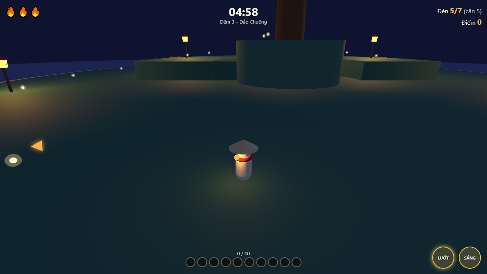

# Đảo Đèn Lồng

> **Video demo:** *(bổ sung ở Phase 4)*
> Day 12 · AI SDLC Lab · Nguyễn Tuấn Phong · 2A202603712 · Tài liệu lab gốc: [docs/lab/](docs/lab/README.md) · Ticket hiện tại: [Ticket-03](docs/lab/ticket-03.md)

Game 3D góc nhìn thứ ba qua **3 Đêm, 3 hòn đảo**. Mây, người giữ đèn nhỏ tuổi, gom đom đóm để thắp và **giữ lửa** các Đèn Lồng Lớn suốt đêm. Từ Phase 3 (Ticket-03), đèn có **nhiên liệu** hao dần; Bóng Mực **hút dầu** các đèn yếu. Mục tiêu là **giữ đủ đèn sáng tới bình minh** — không còn thắng ngay khi thắp hết.



## Cài đặt và chạy (macOS / Linux / Windows, cần Node.js >= 20)

```bash
git clone https://github.com/ntphong4044/K5-L3A-DAY12-NguyenTuanPhong-2A202603712-AI-SDLC-Dao-Den-Long.git && cd K5-L3A-DAY12-NguyenTuanPhong-2A202603712-AI-SDLC-Dao-Den-Long
npm install
npm start          # mở http://localhost:5173
```

## Điều khiển

| Phím | Hành động |
|---|---|
| `W A S D` / `↑ ↓` | Di chuyển (theo hướng camera) |
| `←` `→` hoặc kéo chuột | Xoay camera (độ nhạy chỉnh trong Cài đặt) |
| `Space` | Nhảy |
| `Shift` | Lướt (14 m/s trong 0.2 s, hồi 1.5 s) |
| `E` | Nạp ánh sáng vào Đèn Lồng Lớn ở gần |
| `Q` | Tỏa Sáng: làm choáng và đẩy lùi Bóng Mực trong 5 m (tốn 3 đom đóm, hồi 3 s) |
| `Esc` / `P` | Tạm dừng: Tiếp tục / Chơi lại Đêm / Cài đặt / Về menu |

## Ba Đêm

| Đêm | Đảo | Đèn | Thời gian | Điểm đặc biệt |
|---|---|---|---|---|
| 1 | Đảo Bến: đảo tròn 40 m | 5 | 300 s | Bóng Mực từ giây thứ 5, tối đa 6 |
| 2 | Đảo Cau: 2 đảo + cầu tre | 6 | 330 s | Bục nhảy vàng bay qua biển mây, Gió Lạc, Bùa Gió |
| 3 | Đảo Chuông: 3 tầng, tháp chuông | 7 | 360 s | Dốc, vách đứng, bục nhảy lên tầng 2, gió mạnh mỗi 30 s |

Thắng một Đêm thì sang Đêm kế tiếp. Thắng Đêm 3 thì tới màn **Bình Minh** với tổng điểm. Thua thì chơi lại Đêm đó.

## Luật chơi và cách tính điểm (số chuẩn Ticket-03, Contract v1.2)

- Đi qua đom đóm để nhặt tự động. Mang được **10 + 2 × số lần thắp thành công trong Đêm** (tối đa 20).
- **Đèn Lồng Lớn:**
  - Thắp lần đầu cần **10** đom đóm, **thắp lại** (đèn đã từng sáng) chỉ cần **5**. Có thể nạp dần nhiều lần, đèn nhớ tiến độ.
  - Đèn sáng **hao 1 dầu/giây**. Bấm `E` ở đèn sáng để **châm dầu** (mỗi đom = +10 dầu, đầy 100).
  - Cạn dầu thì đèn **tắt** (ánh sáng môi trường giảm); phải thắp lại.
- **Bóng Mực:**
  - Lượn quanh, đuổi Mây trong 12 m (tốc 4 m/s; Đêm 3: 4.5 m/s), bỏ khi Mây xa hơn 18 m.
  - Bị chạm thì Mây mất 1 Ngọn Lửa, rơi một nửa đom đóm ra đất (nhặt lại được trong 8 s), bất tử 1.5 s.
  - **Hút dầu:** đèn có **fuel < 30 mất vùng an toàn**. Bóng Mực đi tới đèn yếu đó, đứng trong 2 m và **hút 5 dầu/giây** (cộng dồn). Châm dầu đèn lên ≥ 30 để **xua** nó ra trong ≤ 30 tick.
- **Gió Lạc** (Đêm 2, 3): đuổi khi Mây mang từ 5 đom đóm trở lên, cướp 3 con rồi bỏ chạy. Tỏa Sáng trúng nó thì nó thả đồ lại.
- **Bùa Gió** (lá bùa đỏ): trong 10 s Mây chạy 7.2 m/s và lướt không cần hồi chiêu.
- Rơi khỏi đảo thì mất 1 Ngọn Lửa và toàn bộ đom đóm, hồi sinh ở điểm xuất phát.
- **Thắng** khi hết giờ (bình minh) và còn đủ đèn sáng: **3/5, 4/6, 5/7**. **Thua** khi hết 3 Ngọn Lửa, hoặc hết giờ mà không đủ ngưỡng đèn. Thời lượng Đêm **240 / 270 / 300 s**.

| Hành động | Điểm |
|---|---|
| Mỗi đom đóm **nạp** vào đèn (thắp mới, thắp lại, châm dầu) | +5 |
| Thắp đèn lần đầu | +100 |
| Thắp lại | +40 |
| Bóng Mực trúng Tỏa Sáng (mỗi con) | +5 (tổng **+15** nếu ngay trước đó nó đang hút dầu) |
| Khi thắng: mỗi đèn đang sáng | +50 + floor(dầu) |
| Khi thắng: mỗi Ngọn Lửa còn lại | +50 |

Tổng điểm game là tổng điểm các Đêm đã thắng. Mọi con số nằm trong [`game.contract.json`](game.contract.json) (v1.2); lõi game đọc trực tiếp từ file này. Quyết định thiết kế: [ADR-0001](docs/notes/adr-0001-lantern-fuel-and-win.md); breaking changes: [CHANGELOG.md](CHANGELOG.md).

## Test, headless và bằng chứng

```bash
npm test                       # 88 test: unit + 38 scenario headless + tất định 3 Đêm + hiệu năng + mã thoát
npm run proof -- --phase 3     # sinh docs/proof/phase-3/results.md (scenario, sha256, thời gian, bot chơi trọn Đêm)
npm start  &  npm run fps -- "" 20 3   # đo FPS bản web ở 1280×720 bằng Chrome -> docs/proof/phase-3/fps.md
node src/headless.js --seed 1 --night 2 --ticks 21600 --out out.jsonl
```

- Headless theo **Test Contract v1.2**: `--night 1|2|3`, 60 tick/s, tất định theo seed. Inputs có `dash`, `pause`; scenario đèn có `lit`, `fuel`, `ever_lit`, `relit_count`; shade có `target_lantern_id`. File inputs/scenario sai định dạng thì thoát mã 2.
- Bằng chứng:
  - [Phase 1](docs/proof/phase-1/README.md)
  - [Phase 2](docs/proof/phase-2/README.md) (bảng truy vết yêu cầu → bằng chứng)
- [Phase 3](docs/proof/phase-3/README.md) (bảng truy vết Ticket-03 → bằng chứng)
- Spec, tiêu chí nghiệm thu, giả định và đánh giá:
  - [phase-1.md](docs/notes/phase-1.md)
  - [phase-2.md](docs/notes/phase-2.md)
- [phase-3.md](docs/notes/phase-3.md)
- [ADR-0001: đèn có nhiên liệu và luật thắng mới](docs/notes/adr-0001-lantern-fuel-and-win.md)
  - Nhật ký AI: [ai-log.md](docs/notes/ai-log.md)
- CI: GitHub Actions chạy `npm test` + `npm run proof` trên Ubuntu và macOS mỗi lần push.

### Khái niệm contract và giả định cần biết
- `fall_enabled: true`: rơi khi Y < −10, theo Ticket-02.
- Đêm 3 xuất phát tại **(0, 0, −30)**, vì (0, 0, 0) nằm trong tháp chuông (giả định B9).
- Tham số URL chỉ dành cho bản web (không ảnh hưởng headless):
  - `?autostart=N`: vào thẳng Đêm N.
  - `?demo=N`: bot tự chơi.
  - `?bench=N`: bot chơi và hiện FPS.
  - `?fps`: hiện FPS.
  - `?lit=k`: thắp sẵn k đèn để chụp ảnh.

## Cấu trúc

```text
game.contract.json     Test Contract v1.2 (tuning = số chuẩn)
src/core/sim.js        luật chơi tất định, step() theo 12 bước của Ticket-02
src/core/maps.js       bản đồ chuẩn 3 Đêm (surface, điểm sinh, bục nhảy)
src/core/bot.js        bot tìm đường (chỉ để kiểm chứng)
src/core/validate.js   kiểm tra inputs/scenario
src/headless.js        CLI headless
web/                   bản chơi 3D (Three.js) + audio.js (WebAudio)
tests/                 unit, scenario headless (tests/scenarios/*), fixtures
scripts/               serve.js, proof.js, fps-bench.js, hooks/stop-gate.js
docs/lab               tài liệu lab + ticket; docs/notes: spec, giả định, nhật ký AI; docs/proof: bằng chứng
CLAUDE.md, .claude/    harness AI (hướng dẫn, hook Stop, skill verify-phase)
```

## Sáng tạo của tôi

Các phần dưới đây chỉ nằm ở phía hiển thị `web/`. Chúng không đổi luật chơi hay output headless: toàn bộ scenario và test tất định vẫn đạt (xem [results.md](docs/proof/phase-3/results.md)).

- **Đèn lồng trên nón lá của Mây sáng mạnh dần theo số đom đóm đang mang.** Nhìn nhân vật là biết mình đã "đầy ánh sáng" chưa.
- **Vòng sáng an toàn** màu cam hiện trên mặt đất quanh đèn đã thắp, cho thấy chỗ Bóng Mực không vào được.
- **Đom đóm rơi nhấp nháy** trong 2 giây cuối trước khi tan biến.
- **Lời dẫn của Ông Đăng** ở mỗi Đêm, và màn Bình Minh chuyển trời sang màu cam hồng.
- **Gió Lạc** là dải lụa uốn lượn và quay nhanh khi đuổi. Bóng Mực có viền tím phát sáng, phình dần ra khi đang `spawning`.

## Giấy phép

Mã nguồn dùng giấy phép MIT ([LICENSE](LICENSE)). Nguồn thư viện và công cụ được ghi trong [CREDITS.md](CREDITS.md).
