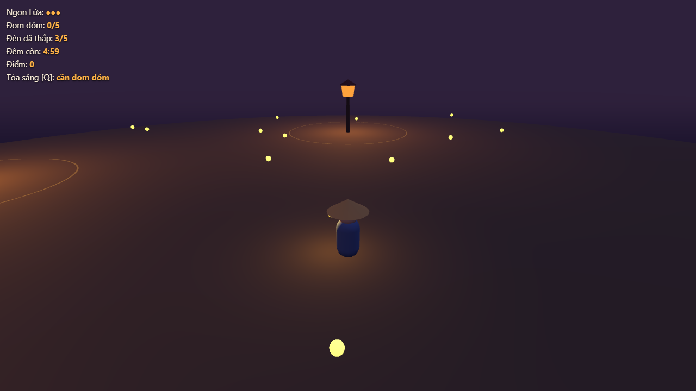

# Đảo Đèn Lồng

> **Video demo:** *(sẽ bổ sung ở Phase 4)*
> Day 12 · AI SDLC Lab · Nguyễn Tuấn Phong · 2A202603712 · Tài liệu lab gốc: [docs/lab/](docs/lab/README.md)

Đây là game 3D góc nhìn thứ ba. Mây, người giữ đèn nhỏ tuổi, gom đom đóm để thắp lại 5 Đèn Lồng Lớn của Đảo Bến trước bình minh và tránh các Bóng Mực trong sương đen.



## Cài đặt và chạy (macOS / Linux / Windows, cần Node.js >= 20)

```bash
git clone https://github.com/ntphong4044/K5-L3A-DAY12-NguyenTuanPhong-2A202603712-AI-SDLC-Dao-Den-Long.git && cd K5-L3A-DAY12-NguyenTuanPhong-2A202603712-AI-SDLC-Dao-Den-Long
npm install
npm start          # mở http://localhost:5173
```

## Điều khiển

| Phím | Hành động |
|---|---|
| `W A S D` / `↑ ↓` | Di chuyển (theo hướng camera) |
| `←` `→` hoặc kéo chuột | Xoay camera |
| `Space` | Nhảy |
| `F` | Nạp đom đóm vào Đèn Lồng Lớn ở gần |
| `Q` | Tỏa sáng: xua Bóng Mực xung quanh (tốn 1 đom đóm, hồi 2 s) |
| `Enter` / `R` | Bắt đầu / chơi lại |

## Luật chơi và cách tính điểm

- Đi qua đom đóm để nhặt tự động. Mang tối đa **5** con.
- Mỗi đèn cần **3** đom đóm. Đứng trong 2.5 m và nhấn `F` để nạp. Thắp đủ **5 đèn** thì **thắng**.
- Bóng Mực xuất hiện từ sương: con đầu ở giây thứ 5, sau đó cứ 20 s một con, tối đa 4 con. Chúng đuổi theo Mây với tốc độ 3.5 m/s (Mây chạy 6 m/s).
  - Bị chạm thì mất **1 Ngọn Lửa** và rơi mất một nửa số đom đóm đang mang, sau đó bất tử 1.5 s.
  - Hết 3 Ngọn Lửa thì **thua**.
- Bóng Mực **không vào được vòng 5 m quanh đèn đã thắp**.
- Đêm dài **300 s**. Hết giờ (bình minh) thì **thua**.

| Hành động | Điểm |
|---|---|
| Nhặt 1 đom đóm | +10 |
| Thắp 1 đèn | +100 |
| Xua 1 Bóng Mực bằng tỏa sáng | +20 |
| Khi thắng: mỗi giây còn lại | +1 |
| Khi thắng: mỗi Ngọn Lửa còn lại | +50 |

Mọi con số nằm trong [`game.contract.json`](game.contract.json), và game đọc trực tiếp từ file này.

### Các khái niệm trong contract mà game không có
- `fall_enabled: false`: đảo không có vực, Mây bị giữ trong bán kính 30 m nên không bao giờ có event `player_hit` với `by: "fall"`.
- Không có `dash`.

## Test, headless và bằng chứng

```bash
npm test                     # 36 test: unit + 8 scenario headless + tất định + mã thoát
npm run proof                # sinh docs/proof/phase-1/results.md và runs/*.jsonl
node src/headless.js --seed 1 --night 1 --scenario tests/scenarios/01-pickup-deposit-light/scenario.json \
     --inputs tests/scenarios/01-pickup-deposit-light/inputs.json --ticks 120 --out out.jsonl
```

- Headless theo **Test Contract v1.0**: 60 tick/s, không cần cửa sổ hay GPU, tất định theo seed. File inputs/scenario sai định dạng thì thoát mã 2.
- Bằng chứng Phase 1: [docs/proof/phase-1/](docs/proof/phase-1/README.md) (bảng truy vết yêu cầu → bằng chứng).
- Giả định và đánh giá: [docs/notes/phase-1.md](docs/notes/phase-1.md). Nhật ký AI: [docs/notes/ai-log.md](docs/notes/ai-log.md).
- CI: GitHub Actions chạy `npm test` + `npm run proof` trên Ubuntu và macOS mỗi lần push.

## Cấu trúc

```text
game.contract.json     Test Contract (tuning = số game dùng thật)
src/core/sim.js        luật chơi tất định (dùng chung headless + web)
src/core/validate.js   kiểm tra inputs/scenario
src/headless.js        CLI headless
web/                   bản chơi 3D (Three.js)
tests/                 unit, scenario headless (tests/scenarios/*), fixtures
scripts/               serve.js, proof.js, bot.js, hooks/stop-gate.js
docs/notes, docs/proof giả định, nhật ký AI, bằng chứng
CLAUDE.md, .claude/    harness AI (hướng dẫn, hook Stop, skill verify-phase)
```

## Sáng tạo của tôi

Các phần dưới đây chỉ nằm ở phía hiển thị `web/`. Chúng không đổi luật chơi hay output headless: scenario và test tất định vẫn đạt (xem [results.md](docs/proof/phase-1/results.md)).

- **Đèn lồng trên nón lá của Mây sáng mạnh dần theo số đom đóm đang mang.** Người chơi nhìn nhân vật là biết mình "đầy ánh sáng" chưa.
- **Vòng sáng an toàn** màu cam hiện trên mặt đất quanh mỗi đèn đã thắp, cho thấy chỗ Bóng Mực không vào được.
- **Đảo ấm dần lên:** bầu trời, sương và mặt đất chuyển từ tím đen sang vàng cam theo số đèn đã thắp (so sánh [0/5](docs/proof/phase-1/img/play.png) và [3/5](docs/proof/phase-1/img/lit3.png)).
- Mây **nhấp nháy** trong thời gian bất tử sau khi bị chạm. Bóng Mực bị choáng thì mờ và nhỏ lại.
- Màn kết thúc có bảng điểm chi tiết (đom đóm, đèn, Bóng Mực bị xua, thưởng thời gian, thưởng Ngọn Lửa).

## Giấy phép

Mã nguồn dùng giấy phép MIT ([LICENSE](LICENSE)). Nguồn thư viện và công cụ được ghi trong [CREDITS.md](CREDITS.md).
