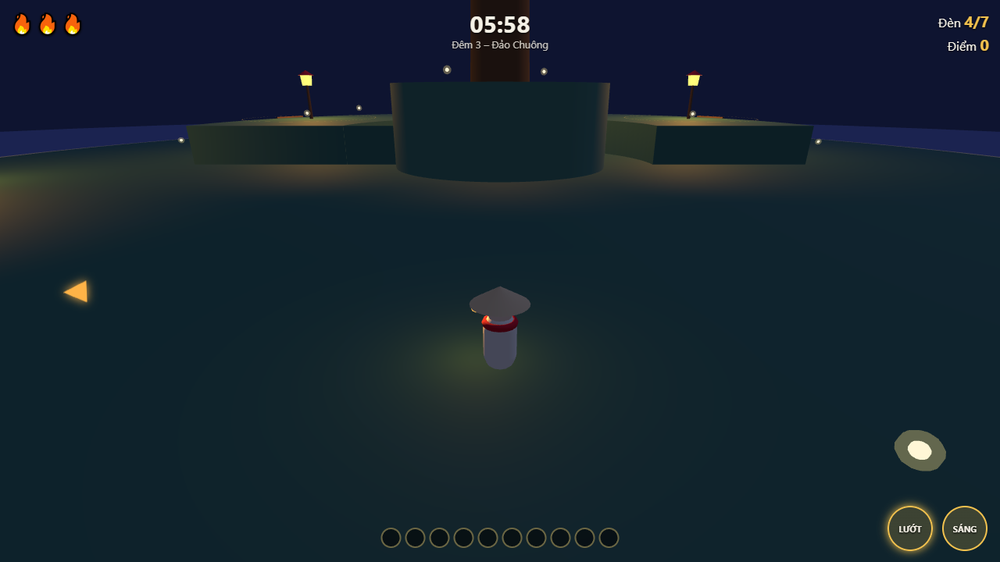

# Đảo Đèn Lồng

> **Video demo:** *(bổ sung ở Phase 4)*
> Day 12 · AI SDLC Lab · Nguyễn Tuấn Phong · 2A202603712 · Tài liệu lab gốc: [docs/lab/](docs/lab/README.md) · Ticket hiện tại: [Ticket-02](docs/lab/ticket-02.md)

Game 3D góc nhìn thứ ba qua **3 Đêm, 3 hòn đảo**. Mây, người giữ đèn nhỏ tuổi, gom đom đóm để thắp lại các Đèn Lồng Lớn trước bình minh. Mây phải né Bóng Mực và giữ đom đóm khỏi tay Gió Lạc.



## Cài đặt và chạy (macOS / Linux / Windows, cần Node.js >= 20)

```bash
git clone https://github.com/ntphong4044/K5-L3A-DAY12-NguyenTuanPhong-2A202603712-AI-SDLC-Dao-Den-Long.git && cd K5-L3A-DAY12-NguyenTuanPhong-2A202603712-AI-SDLC-Dao-Den-Long
npm install
npm start          # mở http://localhost:5173
```

## Điều khiển

| Phím | Hành động |
|---|---|
| `W A S D` / `↑ ↓` | Di chuyển (theo hướng camera) |
| `←` `→` hoặc kéo chuột | Xoay camera (độ nhạy chỉnh trong Cài đặt) |
| `Space` | Nhảy |
| `Shift` | Lướt (14 m/s trong 0.2 s, hồi 1.5 s) |
| `E` | Nạp ánh sáng vào Đèn Lồng Lớn ở gần |
| `Q` | Tỏa Sáng: làm choáng và đẩy lùi Bóng Mực trong 5 m (tốn 3 đom đóm, hồi 3 s) |
| `Esc` / `P` | Tạm dừng: Tiếp tục / Chơi lại Đêm / Cài đặt / Về menu |

## Ba Đêm

| Đêm | Đảo | Đèn | Thời gian | Điểm đặc biệt |
|---|---|---|---|---|
| 1 | Đảo Bến: đảo tròn 40 m | 5 | 300 s | Bóng Mực từ giây thứ 5, tối đa 6 |
| 2 | Đảo Cau: 2 đảo + cầu tre | 6 | 330 s | Bục nhảy vàng bay qua biển mây, Gió Lạc, Bùa Gió |
| 3 | Đảo Chuông: 3 tầng, tháp chuông | 7 | 360 s | Dốc, vách đứng, bục nhảy lên tầng 2, gió mạnh mỗi 30 s |

Thắng một Đêm thì sang Đêm kế tiếp. Thắng Đêm 3 thì tới màn **Bình Minh** với tổng điểm. Thua thì chơi lại Đêm đó.

## Luật chơi và cách tính điểm (số chuẩn Ticket-02)

- Đi qua đom đóm để nhặt tự động, mang tối đa **10**. Mỗi đèn cần **10** đom đóm; có thể nạp nhiều lần, đèn nhớ tiến độ.
- **Bóng Mực:**
  - Lượn ở chỗ của mình, phát hiện Mây trong 12 m thì đuổi với tốc độ 4 m/s (Đêm 3: 4.5 m/s), bỏ đuổi khi Mây xa hơn 18 m.
  - Bị chạm thì Mây mất 1 Ngọn Lửa, rơi một nửa số đom đóm ra đất (nhặt lại được trong 8 s), sau đó bất tử 1.5 s.
  - Bóng Mực không vào được vùng 6 m quanh đèn đã sáng.
- **Gió Lạc** (Đêm 2, 3): đuổi khi Mây mang từ 5 đom đóm trở lên, cướp 3 con rồi bỏ chạy. Tỏa Sáng trúng nó thì nó thả đồ lại.
- **Bùa Gió** (lá bùa đỏ): trong 10 s Mây chạy 7.2 m/s và lướt không cần hồi chiêu.
- Rơi khỏi đảo thì mất 1 Ngọn Lửa và toàn bộ đom đóm, hồi sinh ở điểm xuất phát.
- Hết 3 Ngọn Lửa thì **thua**. Hết giờ (bình minh) thì **thua**. Thắp hết đèn thì **thắng**, kể cả khi đúng tick hết giờ.

| Hành động | Điểm |
|---|---|
| Mỗi đom đóm **nạp** vào đèn | +10 |
| Thắp 1 đèn | +100 |
| Mỗi Bóng Mực trúng Tỏa Sáng (mỗi lần) | +5 |
| Khi thắng: mỗi giây còn lại | +2 |
| Khi thắng: mỗi Ngọn Lửa còn lại | +50 |

Tổng điểm game là tổng điểm các Đêm đã thắng. Mọi con số nằm trong [`game.contract.json`](game.contract.json) (v1.1); lõi game đọc trực tiếp từ file này.

## Test, headless và bằng chứng

```bash
npm test                       # 60 test: unit + 26 scenario headless + tất định 3 Đêm + hiệu năng + mã thoát
npm run proof -- --phase 2     # sinh docs/proof/phase-2/results.md (scenario, sha256, thời gian, bot chơi trọn Đêm)
npm start  &  npm run fps      # đo FPS bản web ở 1280×720 bằng Chrome -> docs/proof/phase-2/fps.md
node src/headless.js --seed 1 --night 2 --ticks 21600 --out out.jsonl
```

- Headless theo **Test Contract v1.1**: `--night 1|2|3`, 60 tick/s, tất định theo seed. Inputs có `dash`, `pause`. File inputs/scenario sai định dạng thì thoát mã 2.
- Bằng chứng:
  - [Phase 1](docs/proof/phase-1/README.md)
  - [Phase 2](docs/proof/phase-2/README.md) (bảng truy vết yêu cầu → bằng chứng)
- Spec, tiêu chí nghiệm thu, giả định và đánh giá:
  - [phase-1.md](docs/notes/phase-1.md)
  - [phase-2.md](docs/notes/phase-2.md)
  - Nhật ký AI: [ai-log.md](docs/notes/ai-log.md)
- CI: GitHub Actions chạy `npm test` + `npm run proof` trên Ubuntu và macOS mỗi lần push.

### Khái niệm contract và giả định cần biết
- `fall_enabled: true`: rơi khi Y < −10, theo Ticket-02.
- Đêm 3 xuất phát tại **(0, 0, −30)**, vì (0, 0, 0) nằm trong tháp chuông (giả định B9).
- Tham số URL chỉ dành cho bản web (không ảnh hưởng headless):
  - `?autostart=N`: vào thẳng Đêm N.
  - `?demo=N`: bot tự chơi.
  - `?bench=N`: bot chơi và hiện FPS.
  - `?fps`: hiện FPS.
  - `?lit=k`: thắp sẵn k đèn để chụp ảnh.

## Cấu trúc

```text
game.contract.json     Test Contract v1.1 (tuning = số chuẩn)
src/core/sim.js        luật chơi tất định, step() theo 12 bước của Ticket-02
src/core/maps.js       bản đồ chuẩn 3 Đêm (surface, điểm sinh, bục nhảy)
src/core/bot.js        bot tìm đường (chỉ để kiểm chứng)
src/core/validate.js   kiểm tra inputs/scenario
src/headless.js        CLI headless
web/                   bản chơi 3D (Three.js) + audio.js (WebAudio)
tests/                 unit, scenario headless (tests/scenarios/*), fixtures
scripts/               serve.js, proof.js, fps-bench.js, hooks/stop-gate.js
docs/lab               tài liệu lab + ticket; docs/notes: spec, giả định, nhật ký AI; docs/proof: bằng chứng
CLAUDE.md, .claude/    harness AI (hướng dẫn, hook Stop, skill verify-phase)
```

## Sáng tạo của tôi

Các phần dưới đây chỉ nằm ở phía hiển thị `web/`. Chúng không đổi luật chơi hay output headless: toàn bộ scenario và test tất định vẫn đạt (xem [results.md](docs/proof/phase-2/results.md)).

- **Đèn lồng trên nón lá của Mây sáng mạnh dần theo số đom đóm đang mang.** Nhìn nhân vật là biết mình đã "đầy ánh sáng" chưa.
- **Vòng sáng an toàn** màu cam hiện trên mặt đất quanh đèn đã thắp, cho thấy chỗ Bóng Mực không vào được.
- **Đom đóm rơi nhấp nháy** trong 2 giây cuối trước khi tan biến.
- **Lời dẫn của Ông Đăng** ở mỗi Đêm, và màn Bình Minh chuyển trời sang màu cam hồng.
- **Gió Lạc** là dải lụa uốn lượn và quay nhanh khi đuổi. Bóng Mực có viền tím phát sáng, phình dần ra khi đang `spawning`.

## Giấy phép

Mã nguồn dùng giấy phép MIT ([LICENSE](LICENSE)). Nguồn thư viện và công cụ được ghi trong [CREDITS.md](CREDITS.md).
